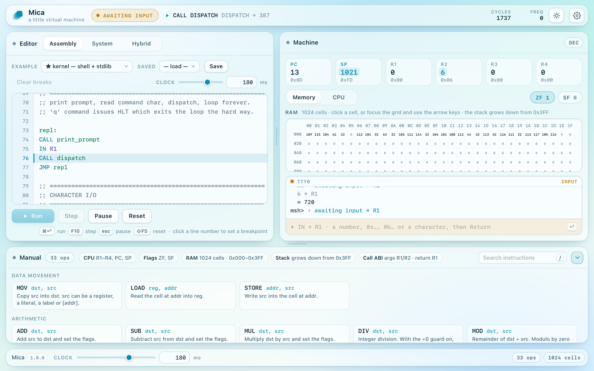
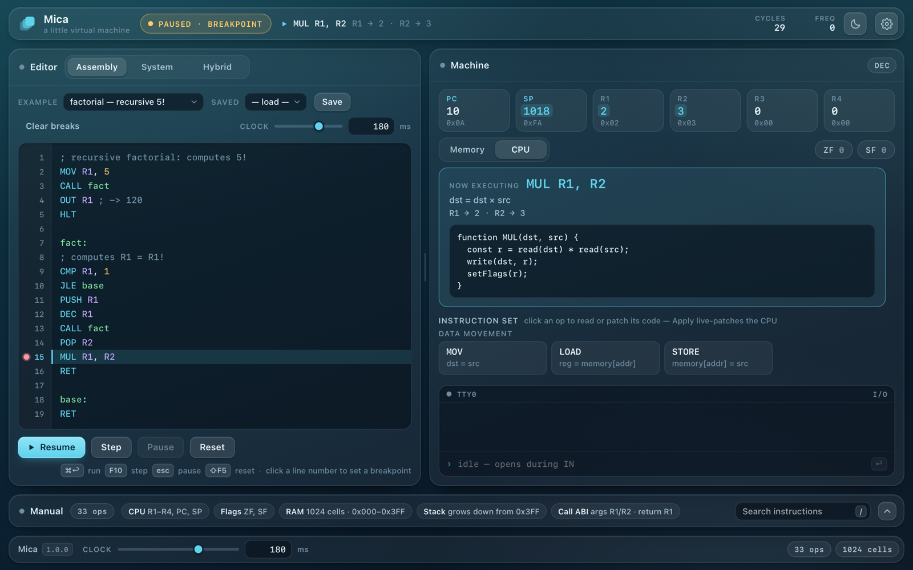
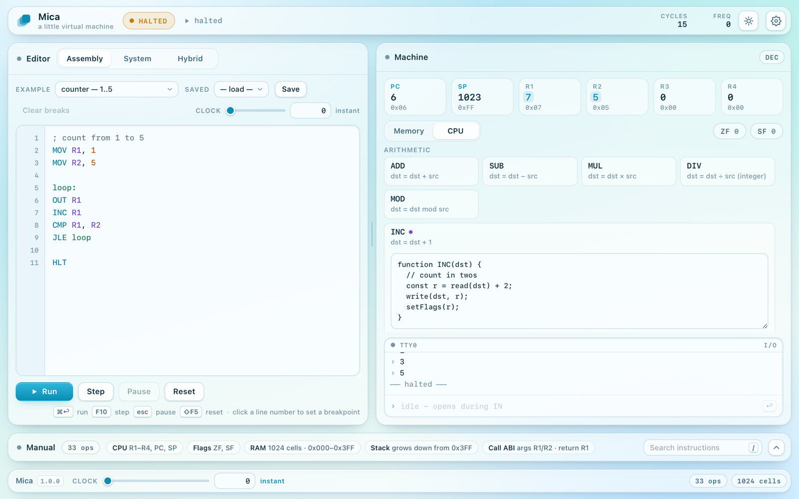
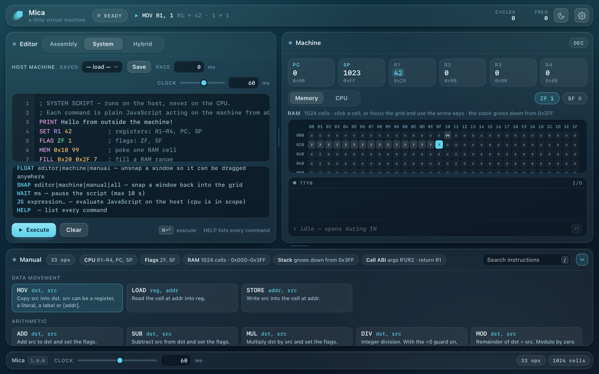
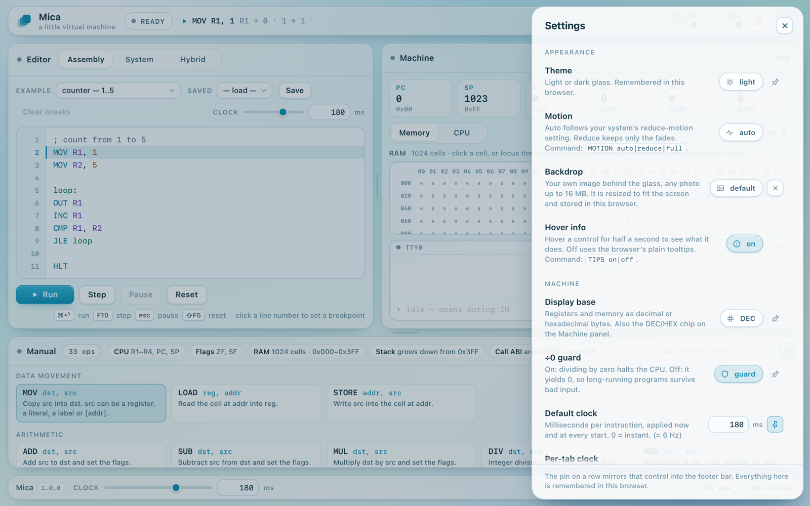

# User manual

Everything in Mica, in the order you meet it on screen. The language itself, every instruction and every System command, is in the [instruction set](instruction-set.md).

## Contents

1. [The window](#1-the-window)
2. [The header](#2-the-header)
3. [The Assembly tab](#3-the-assembly-tab)
4. [Running, stepping and breakpoints](#4-running-stepping-and-breakpoints)
5. [The Machine panel](#5-the-machine-panel)
6. [The CPU tab](#6-the-cpu-tab)
7. [The TTY](#7-the-tty)
8. [The System tab](#8-the-system-tab)
9. [The Hybrid tab](#9-the-hybrid-tab)
10. [The script library](#10-the-script-library)
11. [The Manual panel](#11-the-manual-panel)
12. [Arranging the window](#12-arranging-the-window)
13. [Settings](#13-settings)
14. [The footer](#14-the-footer)
15. [Keyboard shortcuts](#15-keyboard-shortcuts)
16. [What is stored](#16-what-is-stored)

## 1. The window



The window has five parts: the **header** across the top, the **Editor** on the left, the **Machine** on the right, the **Manual** underneath, and the **footer**. Below 881 pixels of width they stack into one column, which scrolls. On a desktop window too short for the Editor and Machine panels, the page scrolls a little rather than cut them off.

## 2. The header

From left to right:

- **The status.** What the CPU is doing:

  | Status | Meaning |
  | --- | --- |
  | READY | reset, nothing has run yet |
  | RUNNING | the clock is running |
  | PAUSED | stopped with Pause or Esc |
  | PAUSED · STEPPING | between two steps |
  | PAUSED · BREAKPOINT | stopped on a breakpoint |
  | AWAITING INPUT | an `IN` instruction waits for a value in the TTY |
  | HALTED | `HLT` ran |
  | HALTED · PC OUT OF RANGE | the program ran past its last instruction, or jumped outside it |
  | CRASHED | an instruction failed; the TTY says which line and why |
  | SYNTAX | Strict run refused to start because the program has syntax errors |
  | HYBRID · CPU | an assembly block of a Hybrid script is running |

- **The next instruction**, with the value of each operand: `▶ ADD R1, R2  R1 → 5 · R2 → 7`. It reads *idle* or *halted* when nothing is about to run.
- **cycles**: the instructions executed since the last reset.
- **freq**: instructions per second, measured over the last 0.7 seconds of running.
- **The theme button** switches between light and dark.
- **The settings button** opens the [settings drawer](#13-settings).

## 3. The Assembly tab

The Editor panel has three tabs. **Assembly** holds the program the CPU runs; [System](#8-the-system-tab) and [Hybrid](#9-the-hybrid-tab) are described further on.

### The toolbar

- **Example** loads one of seven programs: *counter* (1 to 5), *fibonacci* (the first ten), *factorial* (5!, recursively), *multiply* (by repeated addition), *memory* (writing and reading RAM), *bitwise* (AND, OR, XOR, SHL) and the *kernel* (a command shell, section 6 of [Getting started](getting-started.md#6-try-the-kernel)). Loading an example replaces the editor's text, so save your own program first if you want to keep it. Once you edit the text, the menu reads *your program*.
- **Saved** loads a script saved from this tab, and **Save** (⌘S) saves one: see [the script library](#10-the-script-library).
- **Clear breaks** removes every breakpoint. It is greyed out when there are none.
- **Clock** sets this tab's speed in milliseconds per instruction. The slider is logarithmic, from 1 ms to 2 s, so the fast end gets as much travel as the slow end; its far left is 0, which means instant. The field takes any value, fractions included. Each tab keeps its own clock unless you turn *Per-tab clock* off in the settings.

### The editor

The editor colours instructions, registers, numbers, labels and comments. An unknown instruction gets a wavy underline, and with *Syntax check* on, a line with an error gets a red line number. Tab inserts two spaces. Everything you type is saved as you go.

The line about to run is highlighted. Click a line number to set or remove a breakpoint.

### Notices

Two bars can appear under the editor:

- **N syntax errors — line X: …** names the first error. Click it to jump to that line.
- **System commands spotted** appears when the program contains host commands, such as `PRINT` or `FILL`, which the CPU cannot run. Click it, then **Make it hybrid**, to copy the program to the end of the Hybrid tab, where both kinds of line work together. The System tab shows the same bar when its script contains assembly.

## 4. Running, stepping and breakpoints

The four buttons under the editor:

- **Run** (⌘↩) assembles the program and runs it from the top. After a pause it reads **Resume** and carries on from where the CPU stopped.
- **Step** (F10) runs one instruction. While the program is running, Step pauses it instead.
- **Pause** (Esc) stops the clock. The registers, memory and TTY stay as they are.
- **Reset** (⇧F5) clears the registers, the flags, the memory and the TTY, and reads the program again.

**Speed.** At 16 ms per instruction and slower, every instruction is drawn as it runs. Between 1 and 15 ms, several instructions run per screen frame. At 0 the CPU runs flat out in bursts of a few milliseconds, the display catches up once per frame, and the page stays responsive; an endless loop never freezes it, and Pause or Esc always works. The register pulse only plays when you can follow it: when stepping, or at 60 ms and slower.

**Breakpoints** stop a run just before their line executes. Set one by clicking a line number; a breakpoint on a blank line, a comment or a lone label moves to the next instruction when the program is assembled. Breakpoints follow their lines as you edit.

**Editing while paused.** Changes to the program take effect at the next Run from the top, or after Reset. With *Live program* on in the settings, the editor is assembled as you type, so Step always runs what is on screen.

**Crashes.** An instruction that cannot complete halts the CPU with the status CRASHED. The TTY prints `× line N: …` with the reason, for example a division by zero (with the ÷0 guard on), a stack overflow, a memory address outside 0–1023, or an unknown instruction.

## 5. The Machine panel



### Registers

Six cards: **PC** (the program counter: the number of the next instruction), **SP** (the stack pointer), and **R1** to **R4**. Each shows its value large, in the display base, with the other base underneath.

Click a card, or focus it and press Return, to edit it. Type a decimal, hex (`0x2A`) or binary (`0b101`) number, negative or not. Return keeps the new value, Esc cancels, and clicking elsewhere keeps it too.

The **DEC/HEX** chip at the top of the panel switches the display base. In hexadecimal, registers and memory cells show their low byte; the decimal value stays underneath.

### Flags

**ZF** (zero) and **SF** (sign) sit at the right of the Memory/CPU tabs. A set flag is lit. Click one to flip it.

### Memory

The grid shows all 1,024 cells, 32 to a row. Row labels give each row's first address and the column headers each cell's offset in the row, both in hex. A cell's colour shows its state: zero or not, inside the stack (above SP), SP itself (outlined), or written by the last instruction (accent colour).

- **Hover** over a cell for its address in decimal and hex, its value, and whether it is SP or part of the stack. Values that do not fit in a byte also show their low byte.
- **Click** a cell to edit it. Return keeps the value, Esc cancels.
- **From the keyboard**, focus the grid with Tab, then move with the arrow keys. Page Up and Page Down move eight rows, Home and End go to the start and end of the row, and ⌘ or Ctrl with Home and End go to the first and last cell. Return or F2 edits the focused cell, and typing a digit starts an edit with that digit. Screen readers announce each cell as you move: *Address 0x003, value 77*.

## 6. The CPU tab



The **Now executing** card shows the instruction about to run, a one-line summary of what it does, its operands' values, and its code. Click the code to open that instruction for patching.

Below it, **Instruction set** lists all 33 instructions by group. Click one to read its code:

- Edit the code and press **Apply** (⌘↩). Mica compiles your version and the CPU uses it from the next instruction on, mid-run included. If it does not compile, the card says why and the old version stays.
- A patched instruction is marked with a dot, and the Now executing card tags it *patched*.
- **Reset** brings back the original, and **Close** (Esc) folds the card.

Patches last until the page is reloaded. The functions you edit can use `read`, `write`, `writeReg`, `writeMem`, `setFlags`, `jump`, `print`, `printChar`, `requestInput`, `halt`, `cpu`, `MEM_SIZE` and `S` (the settings), and return `true` when they have set the PC themselves. The [instruction set](instruction-set.md#writing-your-own-instructions) describes each one.

## 7. The TTY

The terminal under the memory grid shows what programs print. `OUT` prints a number on its own line, after a `›`; `OUTC` prints one character, and does not start a new line by itself. Host lines sent with the System command `TTY` appear here too.

When an `IN` instruction runs, the input row at the bottom opens and the status reads AWAITING INPUT. Type a value and press Return:

| You type | The CPU gets |
| --- | --- |
| `42`, `-7` | that number |
| `0x2A`, `0b101010` | 42 |
| `A` or `'A'` | 65, the character code |

Anything else is refused with a hint, and the CPU keeps waiting. Once it has a value, a running program carries on, and a program you were stepping stays paused.

Drag the **TTY0** bar up or down to make the terminal taller or shorter; Mica remembers the height. When the window is short, the terminal gives up height before the memory grid does.

## 8. The System tab



The System tab is a host console. Its script runs on the host, in plain JavaScript, outside the CPU, and can read and change anything: registers, flags, memory, the clock, the theme and every setting. One command per line; `;` starts a comment.

```
PRINT Hello from outside the machine!
SET R1 42          ; registers: R1-R4, PC, SP
MEM 0x10 99        ; poke one RAM cell
FILL 0x20 0x2F 7   ; fill a RAM range
DUMP 0x20 16       ; hex view of a range
RUN                ; start the CPU
```

- **Execute** (⌘↩) runs the script from top to bottom. The line running is highlighted.
- **Pace** is the delay between lines, in milliseconds, independent of the CPU's clock. 0 runs the whole script at once.
- **Clock** is the CPU's clock while this tab is active.
- The log under the editor shows each command's result, and errors with their line numbers. **Clear** empties it.

Commands are not case-sensitive, and numbers can be written in decimal, hex or binary. `HELP` lists all 38; the [instruction set](instruction-set.md#system-commands) has the full table.

## 9. The Hybrid tab

A Hybrid script mixes assembly and System commands, line by line, on one machine:

```
FILL 0x40 0x41 5    ; host: two cells of 5
MEM 0x42 32         ; host: one cell of 32
MOV R1, [0x40]      ; CPU from here…
ADD R1, [0x41]
ADD R1, [0x42]
OUT R1
HLT                 ; …to here
JS cpu.registers.R1 ; host again: reads 42
```

Consecutive assembly lines form a **block**. Each block is assembled and run on the CPU to its end, at the tab's clock; then the host lines that follow run, with **Pace** between them. Registers and memory carry over from one part to the next. Labels belong to their block, so a jump cannot leave it. A line that is neither assembly nor a host command is skipped, with a note in the log.

**Execute** (⌘↩) runs the script, **Stop** stops it after the current step, and **Clear** empties the log. Run and Step in the Assembly tab are disabled while a Hybrid script runs.

## 10. The script library

Each tab can save its script under a name. **Save** (⌘S) opens the library for the active tab:

- Type a name (up to 40 characters) and press Return or **Save**. If the name is taken, a note says so, and saving replaces the old script.
- The list shows this tab's saved scripts, newest first, with **Load** and a delete button for each.
- **Export** downloads the whole library, all three tabs, as `mica-scripts.json`. **Import** merges such a file: new names are added, and existing names are replaced.

The **Saved** menu in each tab's toolbar loads a script straight away.

## 11. The Manual panel

The bottom panel is a quick reference: every instruction with its operands and what it does, grouped like the CPU tab, plus the syntax of comments, labels, indirect operands and literals. The pills in its title bar sum up the machine.

- **Search** filters the cards by name, operands and description as you type. Press `/` anywhere to jump there; Esc clears the search, and a second Esc leaves the field.
- The card of the instruction about to run is highlighted when you can follow it: when stepping, or at 60 ms and slower.
- The chevron button at the right folds the panel to its title bar and gives the space to the panels above.

## 12. Arranging the window

- **Resize** the panels by dragging the dividers between them. Double-click a divider to reset it. A focused divider also moves with the arrow keys, 16 pixels at a time, or 64 with Shift. The sizes are remembered.
- **Float a panel** by dragging its title bar: it lifts out of the grid and follows the pointer. Let go near one of the three places in the grid, which an outline marks, and it snaps there; the panel that was there takes its old place. Let go anywhere else and it stays floating, above the rest. Double-click a title bar to send a panel home. The commands `FLOAT` and `SNAP` do the same from a script. Floating needs a window at least 881 pixels wide.
- **Fold the manual** with its chevron button, and drag the **TTY0** bar to size the terminal.

## 13. Settings



The settings button (or Esc to close) opens the drawer. Everything in it is remembered in this browser.

| Setting | What it does | Command |
| --- | --- | --- |
| **Theme** | light or dark glass | `THEME light\|dark\|toggle` |
| **Motion** | *auto* follows the system's reduce-motion setting; *reduce* keeps only fades; *full* animates even when the system asks for less | `MOTION auto\|reduce\|full` |
| **Backdrop** | your own photo behind the glass, up to 16 MB; it is resized to fit the screen, and × removes it | `BACKDROP pick\|clear\|url <link>` |
| **Hover info** | explanations after hovering over a control for half a second; off, the browser's plain tooltips | `TIPS on\|off` |
| **Display base** | registers and memory in decimal or hex | `BASE dec\|hex\|toggle` |
| **÷0 guard** | on, dividing by zero crashes the CPU; off, it gives 0 | `GUARD on\|off` |
| **Default clock** | the clock applied now and at every start, in ms per instruction (0 = instant); the row shows the rate in Hz | `DEFCLOCK ms` |
| **Per-tab clock** | on, each editor tab keeps its own clock; off, they share one | `CLOCKSEP on\|off` |
| **Auto clock switch** | on, switching tabs applies that tab's clock (with Per-tab clock on) | `CLOCKAUTO on\|off` |
| **Syntax check** | errors marked as you type | `LINT on\|off` |
| **Strict run** | Run refuses to start while there are syntax errors | `STRICT on\|off` |
| **Live program** | the program is assembled as you type, so Step runs what is on screen | `LIVE on\|off` |
| **RAM beep** | a short note on every memory write, pitched by the value: off, sine, square, triangle, sawtooth, or your own sample | `SOUND off\|sine\|…\|custom` |
| **Beep volume** | loudness, with a mute button | `VOLUME 0–100`, `MUTE` |
| **Beep pitch** | the base frequency, 50–2000 Hz; higher values climb up to three octaves | `PITCH hz` |
| **Custom beep** | a sound file of your own (up to 1.5 MB) for the RAM beep | `SOUNDFILE pick\|clear` |
| **Reset settings** | every setting back to its default, after a second click to confirm; programs and scripts are kept | |

The **pin** at the end of a row mirrors that control into the footer, so it is always one click away. The clock is pinned by default. `PIN name on|off` pins from a script.

## 14. The footer

The footer shows Mica's version and the **clock** of the active tab, then any controls you pinned from the settings, then the size of the machine.

## 15. Keyboard shortcuts

On Windows and Linux, use Ctrl where this table says ⌘.

| Keys | Where | What |
| --- | --- | --- |
| ⌘↩ | anywhere | run the active tab: Run (or Resume), or Execute |
| F10 | outside text fields | Step |
| Esc | anywhere | close a dialog or the settings, dismiss a message; outside text fields, also pause a run |
| ⇧F5 | outside text fields | Reset |
| ⌘S | anywhere | save the active tab's script; in the library dialog, confirm |
| / | outside text fields | search the manual |
| Tab | in an editor | insert two spaces |
| Return, Esc | editing a register or memory cell | keep, cancel |
| arrows, Page Up/Down, Home/End, Return, F2, digits | memory grid | move, edit |
| arrows, Shift+arrows | a focused divider | resize by 16 or 64 pixels |
| ⌘↩, Esc | patching an instruction | Apply, close |
| Return | the TTY input | send the value |

## 16. What is stored

Mica keeps everything in the browser's local storage for the page's address:

| Key | Holds |
| --- | --- |
| `mica:settings` | every setting, the panel sizes and the pins |
| `mica:theme`, `mica:motion` | read before the page draws, so it opens without a flash |
| `mica:program`, `mica:host`, `mica:hybrid` | the text of the three editors |
| `mica:scripts` | the script library |
| `mica:backdrop`, `mica:beepfile` | your backdrop photo and custom beep, if any |

Clearing the site's data in the browser removes them all. Instruction patches and floating panel positions are not stored; they last until the page is reloaded.
